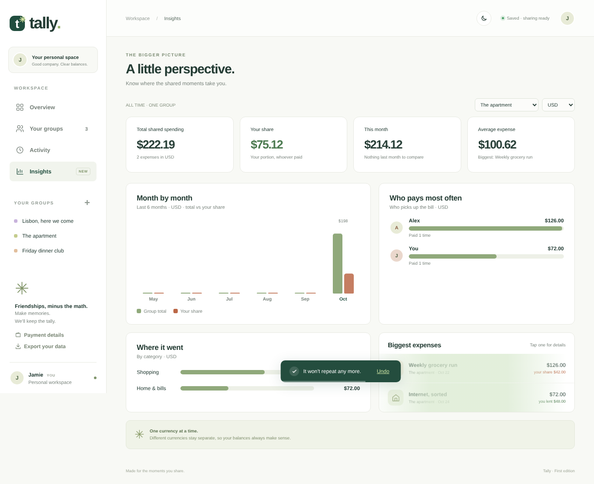
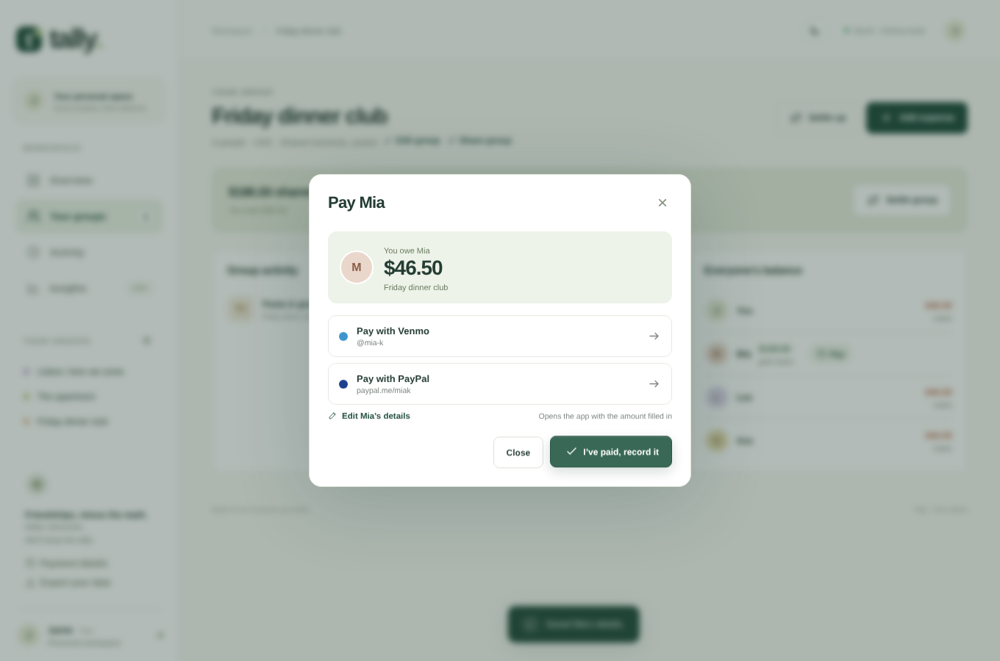
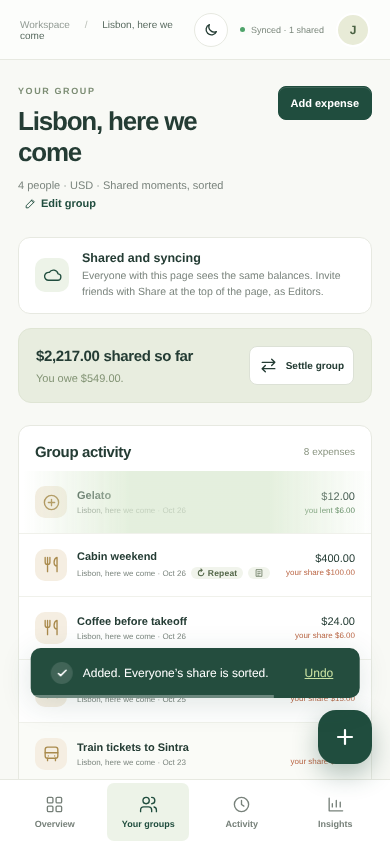
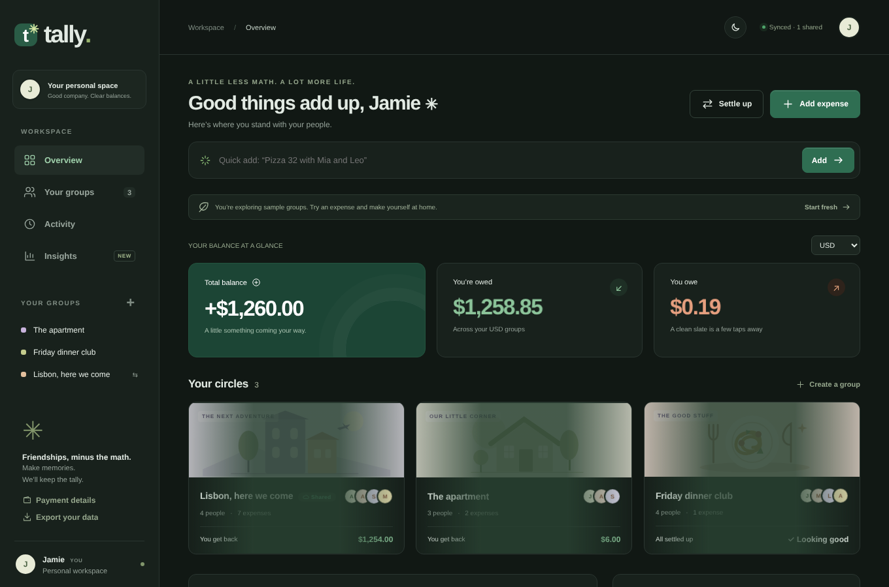

# Tally

A calm little app for splitting shared expenses with friends: trips, flatmates, dinner clubs.
It runs entirely in the browser as a single `index.html` with no build step and no dependencies.

**[▶ Try Tally live](https://arjunreddy91100.github.io/Tally-App/)**: it opens with sample groups, so you can explore right away. Nothing to install.



## Why Tally?

Splitwise is the best-known app for this, and it's great. Tally exists for the moments where it gets in the way.

| | Tally | Splitwise free plan* |
|---|---|---|
| Expenses per day | Unlimited | Blocked after about 3–5 a day |
| Ads | None | Shown between screens |
| Spending charts and search | Free | Pro only |
| Receipt photos | Free | Pro only (scanning) |
| Add an expense by typing a sentence | Yes: `Pizza 32 with Mia and Leo` | No |
| Reminders with a pay link (UPI, Venmo, PayPal) | Yes, amount pre-filled | No |
| Sign-up needed | No, open the link and start | Yes |
| Where your data lives | Your browser (private groups) | Splitwise's servers |
| Open source | Yes | No |

\*As of October 2026, from [Finny's Splitwise pricing breakdown](https://getfinny.app/blog/splitwise-pricing-2026). Splitwise Pro removes these limits for about $4.99 a month in the US.

**What Splitwise does better today:** native iPhone and Android apps, push notifications, accounts that sync across every device, and years of reliability. Tally is a young, open project. If you need those, use Splitwise. If you want something free, fast and private for your next trip or flat, try Tally.

## Features

- **Groups and balances.** Add expenses and see who owes whom. Settle up suggests the fewest payments that clear everyone's balance.
- **Flexible splits.** Split equally, by exact amounts, by percentages or by shares (for example 2 : 1 : 1).
- **Quick add.** Type a sentence like `Tacos 45 with Alex and Sam yesterday` and Tally fills in the amount, group, people, date and category for you.
- **Recurring expenses.** Rent or internet can repeat weekly or monthly, and any dates you missed are filled in automatically.
- **Notes and receipt photos.** Photos are shrunk in the browser before saving.
- **Payment links.** One-tap UPI (INR), Venmo (USD) and PayPal links with the amount pre-filled, plus a "Remind" message that includes your link.
- **Insights.** Spending month by month, who pays most often, biggest expenses, and breakdowns by category and by group.
- **Dark mode, animations and a phone layout,** with support for reduced motion.
- **Shared groups.** When the app is hosted on claude.ai, groups sync live between friends. Anywhere else, data is saved in each person's browser.

| Pay a friend | Phone, shared group | Dark mode |
|---|---|---|
|  |  |  |

## Run it

Open `index.html` in any modern browser. That's it.

### Publish with GitHub Pages

Go to **Settings → Pages**, choose **Deploy from a branch**, and select `main` and `/ (root)`.
After a minute the app is live at `https://<your-username>.github.io/<repo-name>/`.

## Data and privacy

- Private groups are stored in your browser's `localStorage`. Use **Export your data** in the sidebar to keep a JSON backup.
- Tally never moves money. Pay links open your payment app, and you record the payment once it goes through.

## Tests

The browser test drives every feature end to end with Playwright, including two simulated phones syncing a shared group:

```bash
pip install playwright && playwright install chromium
python tests/test_app.py
```
